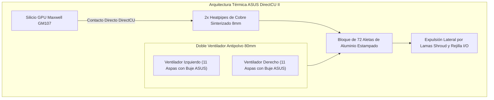

# FICHA TÉCNICA DE INGENIERÍA: ASUS GEFORCE GTX 750 TI DIRECTCU II OC
## Análisis Dimensional, Arquitectura Térmica y Dinámica de Doble Ventilador de 11 Aspas

---

## 1. ESPECIFICACIONES GENERALES DEL COMPONENTE

| Parámetro | Especificación Oficial de Ingeniería |
| :--- | :--- |
| **Identificador del Modelo** | ASUS GeForce GTX 750 Ti OC 2GB DirectCU II (GTX750TI-OC-2GD5) |
| **GPU / Silicio Base** | NVIDIA Maxwell GM107-400-A2 (Litografía 28nm TSMC, $148\text{ mm}^2$, 1.87 mil millones de transistores) |
| **Núcleos CUDA** | 640 Núcleos de sombreado (5 Streaming Multiprocessors SMM) |
| **Unidades de Textura / ROPs** | 40 TMUs / 16 ROPs |
| **Frecuencia Reloj (OC Edition)**| Base: 1,072 MHz / Boost: 1,150 MHz (Overclocked de fábrica vs 1,020 MHz referencia) |
| **Configuración de VRAM** | 2 GB GDDR5 Samsung/SK Hynix (5,400 MHz efectivos) |
| **Bus de Memoria / Ancho de Banda**| 128-bit / $86.4\text{ GB/s}$ |
| **Consumo TDP / Conector** | 60W nominal / Requiere 1x conector PCIe auxiliar de 6 pines para estabilidad en OC |
| **Interfaz de Bus** | PCI Express 3.0 x16 nativo |
| **Salidas de Video** | 2x Dual-Link DVI (DVI-I + DVI-D), 1x HDMI (chapado en oro), 1x DisplayPort / D-Sub |
| **Dimensiones Físicas (L x An x Gr)** | $218.0 \times 115.0 \times 39.0\text{ mm}$ ($8.58 \times 4.53 \times 1.53\text{ pulgadas}$) |
| **Ocupación de Ranuras** | 2.0 Ranuras (Dual-Slot estándar) |
| **Longitud del PCB** | $180.0\text{ mm}$ (La carcasa sobresale $38.0\text{ mm}$ a la derecha) |

---

## 2. INGENIERÍA DE VENTILADORES Y SISTEMA TÉRMICO DIRECTCU II

El diseño de refrigeración DirectCU II de ASUS en este modelo es uno de los más laureados por su balance de presión y silencio:

* **Twin Fans de 80 mm con 11 Aspas Curvadas:**
  * Cada ventilador monta **11 álabes esculpidos** con borde de ataque inclinado y curvatura helicoidal aerodinámica para maximizar la superficie de barrido sin resistencia al giro.
  * Separación inter-aspas real que permite visión directa hacia el bloque de aletas de disipación de aluminio y las tuberías de cobre internas.
  * Diseño **Dust-Proof Fan (Antipolvo):** Sellado IP5X contra partículas que prolonga la vida útil de los ventiladores en hasta un 25% frente a ventiladores estándar.
  * Buje central con anillo exterior reflectante plateado, fondo circular negro pulido y tipografía corporativa blanca **ASUS** con micro-arcos concéntricos *"Inspiring Innovation • Persistent Perfection"*.
* **Tecnología DirectCU (Contacto Directo de Heatpipes):**
  * Dos tubos de calor de cobre de **8 mm de diámetro** aplanados en la base entran en contacto directo con el silicio Maxwell GM107 sin capas intermedias de metal, disipando el calor un 20% más rápido que el disipador de referencia.
* **Componentes Super Alloy Power:**
  * Bobinas de choque con núcleo de aleación que eliminan el zumbido eléctrico (*coil whine*).
  * Condensadores sólidos de aluminio cilíndricos con serigrafía semicircular superior magenta/rosa de 50,000 horas de vida útil (2.5 veces más que los convencionales).
  * Serigrafía en placa fidedigna con códigos de trazabilidad de ingeniería: `APCB M3 94V-0`, `E321N6014AA`, fechador `1341` y marcadores de serigrafía `J71`, `C398`.

---

## 3. ARQUITECTURA TÉRMICA Y FLUJO DE AIRE

---

## 4. CONFORMIDAD FOTORREALISTA CON LA FOTOGRAFÍA REAL DE REFERENCIA

> [!NOTE]
> Este modelo CAD 3D ha sido sincronizado geométricamente y fotométricamente con la imagen de referencia física real (ASUS GeForce GTX 750 Ti DirectCU II OC):

1. **Carcasa DirectCU II:** Cubierta facetada en negro mate con chaflanes angulares a 45°, 3 franjas verticales rojas de carreras en el puente central y 3 franjas rojas verticales en el extremo derecho.
2. **Ventilación Inferior:** Ranuras rectangulares tipo persiana (lamas) a lo largo del perfil inferior de la carcasa para liberar la sobrepresión estática.
3. **Ventiladores Axiales Gemelos:** 11 álabes negros aerodinámicos independientes por rotor, bujes con emblema concéntrico ASUS blanco y bisel plateado, girando dinámicamente con control interactivo de RPM en el visor Three.js.
4. **Disipador y Tubos de Calor:** 72 láminas de aletas de aluminio visibles entre las aspas de los ventiladores con dos tubos de cobre DirectCU de 8 mm atravesando longitudinalmente el disipador.
5. **PCB y Componentes Electrónicos:** PCB negro mate de $180\text{ mm}$ con conectores dorados PCIe 3.0 x16, serigrafía blanca fidedigna (`APCB M3 94V-0`, `E321N6014AA`), condensadores sólidos de aluminio con cabeza magenta/rosa y choque ferrite Super Alloy Power.
6. **Soporte Posterior Dual-Slot:** Bracket de acero inoxidable de 2 ranuras con dos conectores Dual-Link DVI con tornillos hexagonales, HDMI bañado en oro, DisplayPort y ranuras de escape troqueladas.

---

## 5. ARCHIVOS DEL COMPONENTE EN EL DIRECTORIO LOCAL (11 ARCHIVOS EXACTOS)

1. [ESPECIFICACIONES_TECNICAS_GTX_750TI_DIRECTCU_II.md](file:///C:/Users/mathi/Documents/3D/GPU/GPU_ASUS_GEFORCE_GTX_750TI_DIRECTCU_II_OC/ESPECIFICACIONES_TECNICAS_GTX_750TI_DIRECTCU_II.md) - Documento maestro de especificaciones técnicas e ingeniería.
2. [GPU_ASUS_GEFORCE_GTX_750TI_DIRECTCU_II_OC.obj](file:///C:/Users/mathi/Documents/3D/GPU/GPU_ASUS_GEFORCE_GTX_750TI_DIRECTCU_II_OC/GPU_ASUS_GEFORCE_GTX_750TI_DIRECTCU_II_OC.obj) - Malla poligonal 3D CAD paramétrica con rotores de ventilador aislados para animación.
3. [GPU_ASUS_GEFORCE_GTX_750TI_DIRECTCU_II_OC.mtl](file:///C:/Users/mathi/Documents/3D/GPU/GPU_ASUS_GEFORCE_GTX_750TI_DIRECTCU_II_OC/GPU_ASUS_GEFORCE_GTX_750TI_DIRECTCU_II_OC.mtl) - Biblioteca de materiales fotométricos PBR (plástico facetado, cobre sinterizado, aluminio, oro, serigrafía y condensadores con marcas rosas).
4. [GPU_ASUS_GEFORCE_GTX_750TI_DIRECTCU_II_OC_01_iso.png](file:///C:/Users/mathi/Documents/3D/GPU/GPU_ASUS_GEFORCE_GTX_750TI_DIRECTCU_II_OC/GPU_ASUS_GEFORCE_GTX_750TI_DIRECTCU_II_OC_01_iso.png) - Render 2K ($2560 \times 1600$) isométrico 3D fidedigno con logotipo ASUS y franjas rojas.
5. [GPU_ASUS_GEFORCE_GTX_750TI_DIRECTCU_II_OC_02_front.png](file:///C:/Users/mathi/Documents/3D/GPU/GPU_ASUS_GEFORCE_GTX_750TI_DIRECTCU_II_OC/GPU_ASUS_GEFORCE_GTX_750TI_DIRECTCU_II_OC_02_front.png) - Render 2K frontal ortogonal con cotas dimensionales de ingeniería ($218 \times 115 \times 39\text{ mm}$).
6. [GPU_ASUS_GEFORCE_GTX_750TI_DIRECTCU_II_OC_03_side.png](file:///C:/Users/mathi/Documents/3D/GPU/GPU_ASUS_GEFORCE_GTX_750TI_DIRECTCU_II_OC/GPU_ASUS_GEFORCE_GTX_750TI_DIRECTCU_II_OC_03_side.png) - Render 2K de perfil lateral exhibiendo grosor dual-slot, lamas de ventilación y bracket de video.
7. [GPU_ASUS_GEFORCE_GTX_750TI_DIRECTCU_II_OC_04_macro.png](file:///C:/Users/mathi/Documents/3D/GPU/GPU_ASUS_GEFORCE_GTX_750TI_DIRECTCU_II_OC/GPU_ASUS_GEFORCE_GTX_750TI_DIRECTCU_II_OC_04_macro.png) - Render 2K macro close-up sobre las 11 aspas aerodinámicas, buje circular ASUS y aletas internas.
8. [GPU_ASUS_GEFORCE_GTX_750TI_DIRECTCU_II_OC_05_back.png](file:///C:/Users/mathi/Documents/3D/GPU/GPU_ASUS_GEFORCE_GTX_750TI_DIRECTCU_II_OC/GPU_ASUS_GEFORCE_GTX_750TI_DIRECTCU_II_OC_05_back.png) - Render 2K posterior de la placa de circuito impreso con serigrafía `APCB M3 94V-0` y componentes SAP.
9. [OrbitControls.js](file:///C:/Users/mathi/Documents/3D/GPU/GPU_ASUS_GEFORCE_GTX_750TI_DIRECTCU_II_OC/OrbitControls.js) - Controlador de cámara orbital y navegación 3D Three.js.
10. [three.min.js](file:///C:/Users/mathi/Documents/3D/GPU/GPU_ASUS_GEFORCE_GTX_750TI_DIRECTCU_II_OC/three.min.js) - Motor de renderizado WebGL Three.js r128 local.
11. [Visor_3D_ASUS_GeForce_GTX_750Ti_DirectCU_II.html](file:///C:/Users/mathi/Documents/3D/GPU/GPU_ASUS_GEFORCE_GTX_750TI_DIRECTCU_II_OC/Visor_3D_ASUS_GeForce_GTX_750Ti_DirectCU_II.html) - Aplicación interactiva 3D con animación de ventiladores, telemetría y selector de vistas.
