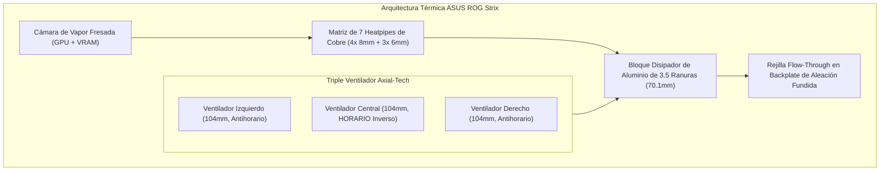

# FICHA TÉCNICA DE INGENIERÍA: ASUS ROG STRIX GEFORCE RTX 4090 OC EDITION
## Análisis Dimensional, Arquitectura Térmica y Dinámica de Fluidos de Ventiladores Axial-Tech

---

## 1. ESPECIFICACIONES GENERALES DEL COMPONENTE

| Parámetro | Especificación Oficial de Ingeniería |
| :--- | :--- |
| **Identificador del Modelo** | ASUS ROG Strix GeForce RTX 4090 24GB GDDR6X OC Edition (ROG-STRIX-RTX4090-O24G-GAMING) |
| **GPU / Silicio Base** | NVIDIA Ada Lovelace AD102-301-A1 (Litografía TSMC 4N personalizada, .5\text{ mm}^2$, 76.3 mil millones de transistores) |
| **Núcleos CUDA** | 16,384 Núcleos de sombreado FP32 |
| **Núcleos Tensor / RT** | 512 Tensor Cores (4.ª Gen) / 128 RT Cores (3.ª Gen) |
| **Frecuencia Reloj (OC Mode)** | 2,640 MHz (Boost Clock) / 2,610 MHz (Default Mode) |
| **Configuración de VRAM** | 24 GB GDDR6X Micron (21 Gbps) sobre bus de 384 bits |
| **Ancho de Banda de Memoria** | 1,008 GB/s (1.008 TB/s) |
| **Consumo TGP / Límites** | 500W TGP nominal (Ajustable por BIOS hasta 600W Max Power Limit) |
| **Interfaz de Bus** | PCI Express 4.0 x16 nativo |
| **Conector de Alimentación** | 1x 16-Pines 12VHPWR (PCIe Gen 5) con sensado de voltaje LED integrado |
| **Dimensiones Físicas (L x An x Gr)** | .6 \times 149.3 \times 70.1\text{ mm}$ (Ocupación de 3.5 Ranuras PCIe) |
| **Peso Total del Ensamblaje** | ,503\text{ g}$ (.50\text{ kg}$) |

---

## 2. INGENIERÍA DE VENTILADORES Y DINÁMICA DE FLUIDOS (AXIAL-TECH)

El sistema de ventilación de la ASUS ROG Strix RTX 4090 representa el estándar más avanzado en tarjetas gráficas dedicadas de escritorio:

* **Triple Ventilador Axial-Tech de 104 mm:**
  * Cada ventilador incorpora 7 aspas aerodinámicas de alta curvatura unidas en su extremo por una **barrera de anillo exterior (Barrier Ring)**.
  * El anillo perimetral evita el desprendimiento del flujo en los bordes de las aspas y canaliza el aire verticalmente hacia el bloque de aletas, logrando un **incremento del 23% en presión estática** respecto a la generación previa.
* **Rotación Inversa del Ventilador Central:**
  * El ventilador izquierdo y el derecho giran en sentido antihorario.
  * El ventilador central gira en **sentido horario**. Esta rotación contrapuesta cancela las turbulencias en las zonas de colisión de aire entre ventiladores adyacentes, minimizando vórtices y reduciendo significativamente la emisión sonora.
* **Tecnología 0dB y Rodamientos de Doble Hilera de Bolas (Dual-Ball Bearings):**
  * Por debajo de 50°C de temperatura de GPU, los tres ventiladores se detienen por completo (0 RPM).
  * Los rodamientos de doble hilera de bolas ofrecen una vida útil de más de 100,000 horas de operación continua a altas temperaturas.
* **Disipador y Cámara de Vapor Fresada:**
  * Cámara de vapor patentada con conductos mecanizados para alojar 4 heatpipes de 8 mm y 3 heatpipes de 6 mm sin aplanarlos, maximizando la eficiencia térmica de transporte.

---

## 3. ARQUITECTURA DE REFRIGERACIÓN Y EXOSQUELETO

---

## 4. ARCHIVOS DEL COMPONENTE EN EL DIRECTORIO LOCAL

1. [GPU_ASUS_ROG_STRIX_GEFORCE_RTX_4090_OC.obj](file:///C:/Users/mathi/Documents/3D/GPU/GPU_ASUS_ROG_STRIX_GEFORCE_RTX_4090_OC/GPU_ASUS_ROG_STRIX_GEFORCE_RTX_4090_OC.obj) - Malla poligonal CAD 1:1.
2. [GPU_ASUS_ROG_STRIX_GEFORCE_RTX_4090_OC.mtl](file:///C:/Users/mathi/Documents/3D/GPU/GPU_ASUS_ROG_STRIX_GEFORCE_RTX_4090_OC/GPU_ASUS_ROG_STRIX_GEFORCE_RTX_4090_OC.mtl) - Materiales fotométricos y acabados PBR.
3. [Visor_3D_ASUS_ROG_Strix_GeForce_RTX_4090_OC.html](file:///C:/Users/mathi/Documents/3D/GPU/GPU_ASUS_ROG_STRIX_GEFORCE_RTX_4090_OC/Visor_3D_ASUS_ROG_Strix_GeForce_RTX_4090_OC.html) - Visor interactivo Three.js.